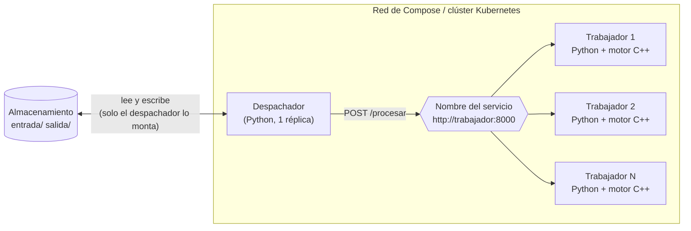

# Arquitectura del servicio

El servicio tiene tres componentes y cada uno vive en su propio contenedor: el
**trabajador** (motor en C++ más una capa HTTP en Python, y es lo que se
replica), el **despachador** (reparte el lote) y el **almacenamiento** (el
volumen con `entrada/` y `salida/`).

El despachador pide siempre al mismo nombre y la capa de red escoge la
réplica: en Compose, la resolución de nombres del servicio (DNS interno, que
rota las direcciones de las réplicas); en Kubernetes, el `Service`. Los
trabajadores no comparten estado ni disco, de modo que el número de réplicas es
el único parámetro que cambia entre una medición y la siguiente.

## Trabajador (`trabajador/trabajador.py`)

Servidor HTTP en Python (solo biblioteca estándar) dentro del mismo contenedor
que el binario del motor. Cada petición escribe la imagen en una carpeta
temporal, ejecuta el motor con `subprocess` (sin shell) y devuelve el
resultado. El cómputo de los filtros se hace en C++; Python solo atiende la
red y llama al binario.

### Contrato HTTP

| Ruta | Descripción |
|---|---|
| `POST /procesar?filtros=gris,gaussiano,sobel,otsu` | Cuerpo: la imagen PPM o PGM en crudo, con `Content-Type: application/octet-stream`. Respuesta: la imagen resultante en el cuerpo (P5 o P6) |
| `GET /healthz` | 200 si el proceso está vivo. Sonda de *liveness* |
| `GET /readyz` | 200 solo si el binario del motor está presente, es ejecutable y responde como el motor (sin argumentos imprime su uso y sale con 2); si no, 503. Sonda de *readiness* |

Cabeceras de la respuesta a `POST /procesar`:

| Cabecera | Contenido |
|---|---|
| `X-Tiempo-Ms` | milisegundos que tardó el motor (la ejecución del binario, sin contar la transferencia por la red) |
| `X-Hilos` | hilos de OpenMP con que corrió (`HILOS` u `OMP_NUM_THREADS`) |
| `X-Trabajador` | nombre del contenedor que atendió la petición; el despachador lo usa para mostrar el reparto |

Códigos de estado:

| Código | Cuándo |
|---|---|
| 200 | listo |
| 400 | filtro desconocido, cadena mal formada o inaplicable (por ejemplo `sobel` sobre una imagen de color), imagen ilegible o `Content-Length` inválido; el cuerpo trae el motivo |
| 404 | ruta inexistente |
| 411 / 413 | falta `Content-Length` / imagen mayor que `MAX_BYTES` |
| 501 | filtro declarado pero sin implementar |
| 503 | `/readyz` con el motor no disponible |
| 504 | el motor pasó de `TIEMPO_MAX` |
| 500 | el motor terminó de forma inesperada |

El nombre de los filtros se valida con `^[a-z_]+(,[a-z_]+)*$` antes de pasarlo
al motor. La cadena completa se comprueba además en el motor *antes* de aplicar
ningún filtro, de modo que un error de canales cuesta una petición y no el
tiempo de los filtros que ya habrían corrido.

El trabajador atiende una imagen a la vez (`MAX_CONCURRENTES=1`): el motor ya
usa los hilos de OpenMP que se le asignan, y dos imágenes simultáneas solo se
estorbarían. Las demás conexiones esperan su turno en el servidor.

Variables de entorno: `PUERTO` (8000), `MOTOR`, `OMP_NUM_THREADS` (hilos del
motor; `HILOS` la sobrescribe), `TIEMPO_MAX` (120 s), `MAX_BYTES`,
`MAX_CONCURRENTES`.

### Por qué las imágenes viajan en crudo

Las imágenes son archivos binarios de varios megabytes (un PPM de 1024x1024 son
3 MB; uno de 4096x4096, 48 MB). Codificarlas en base64 dentro de un JSON las
infla en un tercio (`4/3` de tamaño) y obliga a una conversión de ida y otra de
vuelta en cada petición, tanto en el despachador como en el trabajador. Con el
cuerpo en `application/octet-stream` los bytes del PPM pasan tal cual, sin
copias ni cálculo extra, y los metadatos (filtros, tiempo, hilos) caben en la
consulta y en las cabeceras.

## Despachador (`despachador/despachador.py`)

Programa de Python (biblioteca estándar) que:

1. Lee las imágenes de `<DATOS>/entrada/`. Si la carpeta está vacía, genera el
   lote (`GENERAR`, por defecto 64 imágenes de `TAM`=1024x1024, con ruido
   reproducible por semilla) para que el servicio corra sin pasos manuales.
2. Espera a que el servicio conteste `GET /readyz`.
3. Reparte las imágenes con `ThreadPoolExecutor`, con `CONCURRENCIA`
   peticiones en vuelo (8 por defecto), todas a `URL_TRABAJADOR`.
4. Escribe cada salida en `<DATOS>/salida/` (con extensión `.pgm` o `.ppm`
   según lo que devuelva el trabajador).
5. Imprime la tabla por imagen, el reparto por trabajador y el *throughput*
   en imágenes por segundo, y agrega una fila a `servicio.csv` con las columnas
   `entorno,trabajadores,concurrencia,imagenes,segundos`.

**Cómo reparte.** El despachador no sabe cuántos trabajadores hay ni dónde
están: abre cada petición contra `http://trabajador:8000` (una conexión nueva
por petición, sin reutilizarlas) y la red elige la réplica. Por eso subir de 1 a
4 trabajadores no cambia una línea suya; solo cambia `trabajadores` en la
etiqueta del reporte, que fija quien lanza la medición (`TRABAJADORES_REPORTE`).

**Fallos.** Un fallo de red o un 5xx se reintenta (`REINTENTOS`, 3 veces, con
espera creciente); con el `Service` de por medio, el reintento puede caer en
otra réplica. Un 400, 411, 413 o 501 no se reintenta, porque cualquier réplica
daría la misma respuesta. Si alguna imagen falla, el código de salida es 1 y la
corrida no se anota en `servicio.csv`: un *throughput* con imágenes perdidas
no es comparable.

Variables: `URL_TRABAJADOR`, `CONCURRENCIA`, `FILTROS`, `DATOS`, `GENERAR`,
`TAM`, `REPORTE`, `ENTORNO`, `TRABAJADORES_REPORTE`, `REINTENTOS`,
`TIEMPO_MAX`, `ESPERA_LISTOS`. Cada una tiene su opción de línea de comandos.

## Almacenamiento

Es un volumen con `entrada/` (el lote) y `salida/` (los resultados). **Lo monta
solo el despachador.** Los trabajadores reciben los bytes por HTTP y devuelven
los bytes por HTTP: no tocan disco compartido, y eso es justamente lo que
permite replicarlos sin ninguna coordinación (no hay bloqueos, ni dos réplicas
escribiendo el mismo archivo, ni requisito de un sistema de archivos
compartido entre nodos). El despachador es el único dueño del estado.

## Pruebas

`bash despachador/pruebas.sh` (necesita `make` en `motor/`) levanta un
trabajador real y comprueba el contrato (`/healthz`, `/readyz`, cabeceras,
400 ante un filtro desconocido), reparte un lote de 8 imágenes comparando cada
salida byte a byte con la del motor ejecutado directamente, verifica que el
despachador genera el lote cuando `entrada/` está vacía, y prueba los
reintentos ante un servicio que da 503 a propósito, el no-reintento ante un 400
y el código de salida 2 si el servicio nunca está listo.
