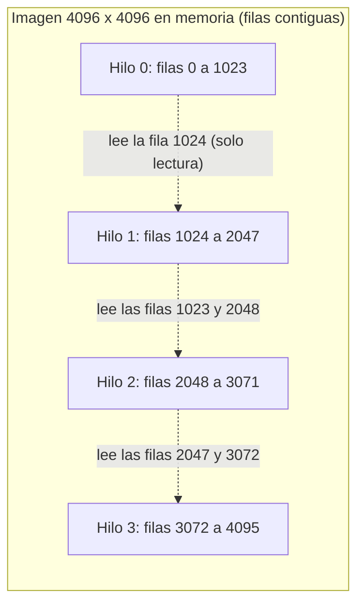

 El motor

## Filtro implementado: desenfoque gaussiano separable

Núcleo binomial `[1 4 6 4 1]/16` en una pasada horizontal y otra vertical. Se
respetan las convenciones del README: bordes por repetición del píxel más
cercano, acumulación en `double` y redondeo solo al final. La intermedia no se
redondea. Como los pesos son enteros y se divide entre 16, las sumas en
`double` son exactas, y por eso las tres versiones dan la misma salida byte a
byte.

Las versiones, en `motor/src/filtros.cpp`:

| Versión | Qué hace |
|---|---|
| `gaussiano_secuencial` | las dos pasadas con un hilo |
| `gaussiano_paralelo` | las dos pasadas con `omp parallel for` por filas, con la intermedia completa en memoria |
| `gaussiano_paralelo_bandas` | pedida como `gaussiano_bandas`; ver la optimización de localidad |

## Paralelización

Cada fila de la intermedia sale de una sola fila de la entrada, y cada fila de
salida lee cinco filas de la intermedia y escribe solo la suya. No hay datos
compartidos que se escriban, así que basta repartir filas con
`schedule(static)`. Entre las dos pasadas hay una barrera, que es la del final
del primer `for`.

## Corrección

`make pruebas` compara:

- la salida contra `tests/esperado_gaussiano.py`, una implementación aparte
  que aplica el núcleo 2D de 5x5 directo (no separable), sobre la imagen de
  4x3, sobre un canal y sobre una de 37x41 (no es múltiplo de la banda);
- paralelo, dos pasadas y bandas contra la secuencial en 512x512;
- tamaños de 1x1, 2x3, 5x1, 1x7, 16x16 y 17x33, donde todo o casi todo es borde.

## Metodología de medición

- Imagen de 4096x4096 a color, escrita por `generar`.
- Se cronometra solo la llamada al filtro, con la imagen ya en memoria
  (`omp_get_wtime`).
- 5 repeticiones por filtro e hilos; se descarta la primera y se toma la
  mediana de las otras cuatro.
- Hilos: 1, 2, 4 y 8, con `OMP_NUM_THREADS`.
- Speedup = T(1 hilo) / T(p hilos) del mismo filtro; eficiencia = speedup / p.
- `bash bench/medir.sh imagen.ppm gaussiano gaussiano_bandas` deja
  `mediciones/motor.csv`, y `python3 bench/resumir.py` saca las tablas.

Máquina: Intel(R) Core(TM) i5-3470 CPU @ 3.20GHz; 1 socket × 4 núcleos
físicos, 1 hilo por núcleo (4 CPU totales; `nproc`: 4). `free -h` informa 11Gi
de memoria total (5,9Gi usados, 1,4Gi libres, 143Mi compartidos, 4,2Gi en
búfer/caché y 5,7Gi disponibles) y 5,1Gi de swap (0B usados). Distribución:
Debian GNU/Linux 13.8 (trixie); compilador `g++ (Debian 14.2.0-19)` con
`-O2 -fopenmp`.

Las mediciones de Gaussiano de las tablas siguientes se realizaron en otra PC,
distinta de la descrita aquí; sus tiempos y speedups no corresponden a esta
máquina. Las mediciones de Sobel sí corresponden a la máquina descrita arriba.

## Resultados

Dos pasadas (antes de optimizar):

| hilos | mediana (ms) | speedup | eficiencia |
|---|---|---|---|
| 1 | 461.0 | 1.00 | 1.00 |
| 2 | 266.5 | 1.73 | 0.86 |
| 4 | 189.0 | 2.44 | 0.61 |
| 8 | 190.0 | 2.43 | 0.30 |

Por bandas (después):

| hilos | mediana (ms) | speedup | eficiencia |
|---|---|---|---|
| 1 | 318.0 | 1.00 | 1.00 |
| 2 | 161.5 | 1.97 | 0.98 |
| 4 | 91.5 | 3.48 | 0.87 |
| 8 | 82.0 | 3.88 | 0.48 |

Antes y después a igual número de hilos:

| hilos | antes (ms) | después (ms) | mejora |
|---|---|---|---|
| 1 | 461.0 | 318.0 | 1.45x |
| 2 | 266.5 | 161.5 | 1.65x |
| 4 | 189.0 | 91.5 | 2.07x |
| 8 | 190.0 | 82.0 | 2.32x |

La versión de dos pasadas deja de mejorar a partir de 4 hilos (189 ms con 4 y
190 con 8). La de bandas sigue bajando hasta 8 hilos y con 4 mantiene una
eficiencia de 0.87.

## Optimización de localidad: fusión por bandas

**Problema.** Con dos pasadas completas, la intermedia en `double` ocupa
4096 x 4096 x 3 x 8 bytes, unos 400 MB. Se escribe entera en la primera pasada
y se vuelve a leer entera en la segunda. El filtro hace pocas cuentas por byte
que mueve, así que lo limita el ancho de banda de memoria, y ese es un recurso
que los hilos comparten: con 2 hilos el speedup es 1.73x, con 4 llega a
2.44x y con 8 ya no mejora.

**Cambio.** La imagen se parte en bandas de 32 filas. Cada hilo filtra en
horizontal las 36 filas que necesita (32 más 2 de borde arriba y 2 abajo) hacia
un búfer propio, y con eso hace la pasada vertical de su banda. El búfer tiene
36 x 4096 x 3 x 8 = 3.5 MB y se reutiliza, así que la intermedia casi nunca
sale de caché. A cambio, las 4 filas de borde de cada banda se filtran dos
veces (cerca de 12 % más de cuentas horizontales).

**Efecto.** Con un hilo ya baja de 461 a 318 ms, porque se evita el viaje de
ida y vuelta a memoria principal. El speedup con 8 hilos pasa de 2.43 a 3.88,
y el tiempo absoluto de 190 a 82 ms (2.32x). A 8 hilos la eficiencia sigue
siendo baja (0.48); los resultados son compatibles con un límite del ancho de
banda o del número de núcleos físicos de la PC donde se hizo esa prueba, pero
no se midieron esos recursos por separado.

**Tamaño de banda.** El valor de 32 filas se escogió probando 4, 8, 16, 32, 64
y 128 en otra máquina (de 2 CPU): 4 y 8 fueron peores y de 32 en adelante casi
no cambió. No se repitió el barrido en la máquina descrita arriba, y el valor
óptimo depende del tamaño de la caché por núcleo (`BANDA_FILAS` en
`filtros.hpp`).

## Sobel y magnitud del gradiente

> La metodología de medición es la de la sección anterior (imagen de
> 4096x4096, 5 repeticiones, se descarta la primera y se toma la mediana de las
> cuatro restantes). La máquina es la declarada al comienzo del archivo:
> Intel(R) Core(TM) i5-3470, 4 núcleos físicos y 4 CPU totales (1 hilo por
> núcleo), 11Gi de memoria total y Debian GNU/Linux 13.8 (trixie), con
> `g++ (Debian 14.2.0-19)`.

### Qué calcula

Estima la derivada de la intensidad en las dos direcciones con dos máscaras de
$3\times 3$ sobre una imagen de un canal:

$$
G_x=\begin{pmatrix}-1&0&1\\-2&0&2\\-1&0&1\end{pmatrix}\qquad
G_y=\begin{pmatrix}-1&-2&-1\\0&0&0\\1&2&1\end{pmatrix}
$$

$$
O(x,y)=\min\!\Big(255,\ \operatorname{redondeo}\big(\sqrt{g_x^2+g_y^2}\big)\Big)
$$

Es un *stencil* con dos máscaras sobre la misma vecindad. Si recibe una imagen
de tres canales, el motor la rechaza con `sobel necesita una imagen de un
canal` antes de aplicar nada.

### Implementación

Las versiones, en `motor/src/filtros.cpp`:

| Versión | Qué hace |
|---|---|
| `sobel_secuencial` | recorre filas y columnas con un hilo |
| `sobel_paralelo` | igual, con `omp parallel for schedule(static)` sobre las filas |

Las dos llaman a la misma función `sobel_pixel`, así que solo difieren en el
reparto del ciclo de filas. Se respetan las convenciones del README:

- **Bordes por repetición del píxel más cercano**, con `recortar`.
- **La vecindad se lee una sola vez**: los nueve vecinos van a un arreglo local
  y de ahí salen $g_x$ y $g_y$. Aplicar las máscaras en dos pasadas leería la
  vecindad dos veces.
- **$g_x$ y $g_y$ son enteros exactos** ($|g|\le 1020$). La única operación en
  coma flotante es `std::sqrt` sobre `double`, que IEEE 754 exige correctamente
  redondeada; el redondeo y la saturación los hace `redondear`.

Como no hay dependencias entre píxeles, la aritmética es determinista y cada
hilo escribe solo sus filas, la salida paralela es idéntica a la secuencial
para cualquier número de hilos.

### Paralelización

```cpp
#pragma omp parallel for schedule(static)
for (int y = 0; y < e.alto; ++y)
    for (int x = 0; x < e.ancho; ++x)
        s.poner(x, y, 0, sobel_pixel(e, x, y));
```

**Por qué el reparto va sobre las filas.** La imagen está en memoria por filas
y cada píxel de un canal es un byte, así que una línea de caché de 64 bytes
trae 64 píxeles consecutivos de la misma fila. Repartir filas deja a cada hilo
una banda contigua y el ciclo interno avanza por $x$ aprovechando cada línea
traída; las filas $y-1$, $y$, $y+1$ de la vecindad ya están en caché por la
fila anterior. Recorrer por columnas avanzaría $W=4096$ bytes por paso y cada
acceso caería en una línea distinta.



*Ejemplo con 4 hilos. Las flechas son las únicas lecturas que cruzan de una
banda a otra; son lecturas, no escrituras, así que no hay carreras.*

**Planificación.** `schedule(static)`: el costo por píxel es uniforme, así que
el reparto previo no deja hilos ociosos y `dynamic` o `guided` solo agregarían
el costo de pedir trozos. **False sharing:** dos hilos vecinos solo comparten,
como mucho, la línea de caché de la frontera entre sus bandas, una por
frontera; es despreciable.

**Fracción secuencial.** El ciclo de filas es paralelo entero. Queda secuencial
lo que ocurre dentro de la llamada cronometrada pero fuera del `parallel for`:
la inicialización a cero de los $W\cdot H=16\,777\,216$ bytes de la salida
(`resize`) y el *fork-join*. Con la métrica de Karp-Flatt,

$$
e(p)=\frac{1/S(p)-1/p}{1-1/p},
$$

se estima la fracción secuencial efectiva con los datos medidos (tabla de
abajo).

### Corrección

`make pruebas` compara:

- la salida contra `tests/datos/sobel_gris.pgm` (imagen de prueba de 4x3) y
  `tests/datos/sobel_medio.pgm` (37x41, que no es múltiplo del reparto), que
  calculó `tests/esperado_sobel.py`, una implementación aparte hecha con NumPy
  (sumas de arreglos desplazados, bordes con `np.pad` en modo `edge`);
- que una imagen constante dé cero en todos los píxeles, que es lo que debe dar
  un filtro de bordes donde no hay cambios;
- `sobel` paralelo contra el secuencial en 512x512, con `OMP_NUM_THREADS=1` y
  `8`, y lo mismo para la cadena `gris,gaussiano,sobel` (se completará con
  `otsu` cuando esté implementado);
- tamaños de 1x1, 2x3, 5x1, 1x7, 16x16 y 17x33, donde todo o casi todo es
  borde, paralelo contra secuencial.

Los archivos esperados se generan una vez y se versionan, así que `make
pruebas` no necesita NumPy; solo hace falta para regenerarlos:

```bash
./motor gris tests/datos/medio.ppm /tmp/medio_gris.pgm
python3 tests/esperado_sobel.py /tmp/medio_gris.pgm tests/datos/sobel_medio.pgm
python3 tests/esperado_sobel.py tests/datos/gris.pgm tests/datos/sobel_gris.pgm
```

Salida de `make pruebas` (`bash tests/pruebas.sh`), en la máquina de las
mediciones:

```console
Salida esperada, calculada aparte:
  ok    gris sobre la imagen de prueba
  ok    caja sobre la imagen de prueba
  ok    gaussiano sobre la imagen de prueba
  ok    gaussiano sobre un canal
  ok    gaussiano sobre 37x41, contra la implementación aparte
  ok    gaussiano_bandas sobre 37x41, contra la implementación aparte
Lectura y escritura:
  ok    gris rechaza una imagen de un canal
  ok    caja sobre un canal escribe P5
Paralelo contra secuencial, imagen de 512x512:
  ok    gris idéntico con uno y con varios hilos
  ok    caja idéntico con uno y con varios hilos
  ok    gaussiano idéntico con uno y con varios hilos
  ok    gaussiano_bandas idéntico con uno y con varios hilos
Tamaños pequeños y bordes, gaussiano:
  ok    gaussiano 1x1: dos pasadas y bandas iguales a la secuencial
  ok    gaussiano 2x3: dos pasadas y bandas iguales a la secuencial
  ok    gaussiano 5x1: dos pasadas y bandas iguales a la secuencial
  ok    gaussiano 1x7: dos pasadas y bandas iguales a la secuencial
  ok    gaussiano 16x16: dos pasadas y bandas iguales a la secuencial
  ok    gaussiano 17x33: dos pasadas y bandas iguales a la secuencial
Sobel:
  ok    sobel sobre la imagen de prueba de 4x3
  ok    sobel sobre 37x41, contra la implementación aparte
  ok    sobel de una imagen constante da cero en todos los píxeles
Sobel, paralelo contra secuencial, imagen de 512x512:
  ok    sobel idéntico a la secuencial con 1 hilos
  ok    gris,gaussiano,sobel idéntica a la secuencial con 1 hilos
  ok    sobel idéntico a la secuencial con 8 hilos
  ok    gris,gaussiano,sobel idéntica a la secuencial con 8 hilos
Tamaños pequeños y bordes, sobel:
  ok    sobel 1x1: paralelo igual a la secuencial
  ok    sobel 2x3: paralelo igual a la secuencial
  ok    sobel 5x1: paralelo igual a la secuencial
  ok    sobel 1x7: paralelo igual a la secuencial
  ok    sobel 16x16: paralelo igual a la secuencial
  ok    sobel 17x33: paralelo igual a la secuencial
Filtro desconocido:
  ok    la cadena con un filtro inexistente se rechaza
Cadenas que no se pueden aplicar:
  ok    sobel se rechaza antes de aplicar nada
  ok    gris,gris se rechaza antes de aplicar nada
  ok    otsu se rechaza antes de aplicar nada

todas las pruebas pasaron
```

### Resultados

Medianas de las cuatro repeticiones útiles del filtro `sobel` (5 repeticiones
por configuración, se descarta la primera) sobre una imagen de 4096x4096. La
medición se hizo desde una terminal, sin el IDE ni otras aplicaciones abiertas
(carga media de 0.79 al iniciar).

| hilos | mediana (ms) | speedup | eficiencia | Karp-Flatt $e$ |
|---|---|---|---|---|
| 1 | 403.26 | 1.00 | 1.00 | - |
| 2 | 221.328 | 1.82 | 0.91 | 0.098 |
| 4 | 128.138 | 3.15 | 0.79 | 0.090 |
| 8 | 142.87 | 2.82 | 0.35 | 0.262 |

$$
S(p)=\frac{T(1)}{T(p)}\qquad E(p)=\frac{S(p)}{p}
$$

**Lectura.**

- Sobel escala bien hasta 4 hilos: con 2 obtiene 1.82x y con 4 alcanza 3.15x
  de speedup, con una eficiencia de 0.79.
- Con 8 hilos el tiempo sube de 128.1 a 142.9 ms respecto de 4 hilos, aunque
  sigue siendo 2.82x más rápido que con un hilo. La eficiencia baja a 0.35.
  Como la máquina tiene 4 núcleos físicos, 8 hilos los sobresuscriben; los datos
  muestran que aquí no mejora seguir aumentando los hilos, pero no permiten
  atribuir esa caída a una causa única.
- $e(p)$ es 0.098 con 2 hilos y 0.090 con 4, valores cercanos que reflejan una
  buena escalabilidad hasta los núcleos físicos. A 8 hilos aumenta a 0.262,
  consistente con el menor rendimiento observado en esa configuración. Con
  $e\approx 0.09$ con 2 y 4 hilos, la fracción secuencial efectiva es de
  alrededor del 9 %, que incluye la inicialización a cero de la salida y el
  *fork-join*; no se midió por separado.
- No se compara con la del gaussiano: sus
  cifras de este archivo se midieron en otra PC, y poner lado a lado tiempos de
  dos máquinas distintas no dice cuál de los dos filtros escala peor.

### Perfilado

Herramienta: `perf stat`, sobre el binario `arnes` (no sobre el código fuente:
el perfilador mide el programa ya compilado mientras corre el filtro). Esta es
una captura independiente en la misma máquina y con una imagen de 4096x4096,
hecha desde consola sin otras aplicaciones abiertas:

```bash
./generar /tmp/medicion.ppm 4096 4096
./motor gris /tmp/medicion.ppm /tmp/medicion.pgm
for h in 1 2 4 8; do
  OMP_NUM_THREADS=$h LC_ALL=C perf stat -r 3 -e task-clock,cycles,instructions,cache-references,cache-misses \
      ./arnes sobel /tmp/medicion.pgm 5 > /dev/null 2> /tmp/perf_sobel_$h.txt
done
```

`perf stat` repite el proceso 3 veces (`-r 3`); cada proceso lee la imagen y
ejecuta el filtro 5 veces, y los contadores y el tiempo transcurrido son el
promedio por proceso. El IPC se calcula como instrucciones / ciclos y el
porcentaje de fallos como cache-misses / cache-references. Los tiempos
transcurridos incluyen las cinco repeticiones y la lectura de la imagen, y la
captura es una corrida distinta de la de la tabla de Resultados (en ella el
`arnes` imprimió medianas de unos 383 ms con 1 hilo y de 103 a 110 ms con 4),
por eso no son directamente comparables con esas medianas.

| hilos | ciclos (mil millones) | instrucciones (mil millones) | IPC | fallos de caché (millones) | fallos (%) | CPUs utilizadas | tiempo transcurrido (s) |
|---|---|---|---|---|---|---|---|
| 1 | 6.931 | 21.249 | 3.066 | 1.332 | 55.30 | 1.00 | 1.9437 |
| 2 | 6.966 | 21.263 | 3.052 | 1.327 | 55.63 | 1.98 | 0.9864 |
| 4 | 7.044 | 21.294 | 3.023 | 1.350 | 54.89 | 3.89 | 0.5455 |
| 8 | 6.949 | 21.254 | 3.059 | 1.348 | 49.57 | 3.66 | 0.6219 |

Salida cruda de `/tmp/perf_sobel_1.txt`:

```text
sobel con 1 hilo: mediana 383.547 ms sobre 4 corridas
sobel con 1 hilo: mediana 383.92 ms sobre 4 corridas
sobel con 1 hilo: mediana 383.187 ms sobre 4 corridas

 Performance counter stats for './arnes sobel /tmp/medicion.pgm 5' (3 runs):

           1942.32 msec task-clock                       #    0.999 CPUs utilized               ( +-  0.15% )
        6930535755      cycles                           #    3.568 GHz                         ( +-  0.04% )
       21249215877      instructions                     #    3.07  insn per cycle              ( +-  0.00% )
           2408208      cache-references                 #    1.240 M/sec                       ( +-  0.64% )
           1331646      cache-misses                     #   55.30% of all cache refs           ( +-  0.49% )

           1.94371 +- 0.00296 seconds time elapsed  ( +-  0.15% )
```

Salida cruda de `/tmp/perf_sobel_4.txt`:

```text
sobel con 4 hilos: mediana 103.274 ms sobre 4 corridas
sobel con 4 hilos: mediana 105.729 ms sobre 4 corridas
sobel con 4 hilos: mediana 109.699 ms sobre 4 corridas

 Performance counter stats for './arnes sobel /tmp/medicion.pgm 5' (3 runs):

           2121.41 msec task-clock                       #    3.889 CPUs utilized               ( +-  1.39% )
        7043511136      cycles                           #    3.320 GHz                         ( +-  0.07% )
       21293553576      instructions                     #    3.02  insn per cycle              ( +-  0.00% )
           2460151      cache-references                 #    1.160 M/sec                       ( +-  0.38% )
           1350387      cache-misses                     #   54.89% of all cache refs           ( +-  0.79% )

           0.54555 +- 0.00658 seconds time elapsed  ( +-  1.21% )
```

Con 1, 2, 4 y 8 hilos las instrucciones totales (21.249–21.294 mil millones) y
los ciclos totales (6.931–7.044 mil millones) casi no cambian, y el IPC se
mantiene entre 3.02 y 3.07: la paralelización no agrega trabajo. Los fallos de
caché también son estables (1.33–1.35 millones, unos 0.06 por cada mil
instrucciones), de modo que estos contadores no muestran presión creciente
sobre la memoria; el filtro pasa su tiempo calculando.

Hasta 4 hilos las CPUs activas siguen al número de hilos (1.00, 1.98 y 3.89) y
el tiempo transcurrido baja casi en proporción (de 1.9437 s a 0.5455 s, 3.56x).
Con 8 hilos el tiempo sube a 0.6219 s y las CPUs activas bajan a 3.66: el
tiempo adicional no es trabajo adicional, sino menor ocupación de los núcleos,
compatible con la sobresuscripción de 4 núcleos físicos, aunque los contadores
por sí solos no prueban esa causa. El speedup de 3.56x con 4 hilos difiere del
3.15x de la tabla de Resultados porque el tiempo de `perf` incluye cinco
repeticiones y la lectura de la imagen, y procede de otra corrida; la tendencia
es la misma.

### Optimización de localidad

No se aplicó una optimización de localidad a Sobel. Con 4 hilos los 4 núcleos
están ocupados (3.89 CPUs activas), el IPC es cercano a 3.0 y los fallos de
caché no crecen con los hilos, de modo que el perfilado no muestra un límite de
memoria que una optimización de localidad pueda corregir; además, calcular
$g_x$ y $g_y$ en un solo recorrido ya forma parte de la implementación base.
La optimización del equipo se aplicó al gaussiano (ver su sección).
